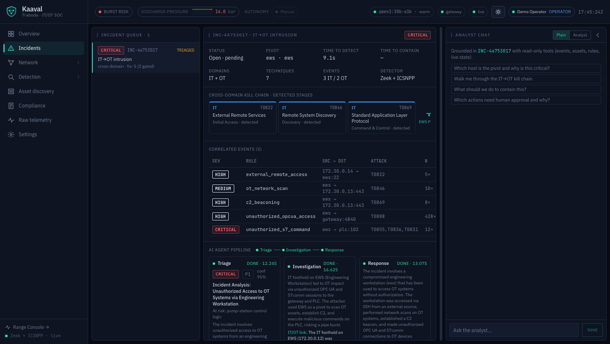

# Kaaval — agentic IT/OT SOC (by Traboda)

**Kaaval** (Tamil: *guard / watch*) is a local, self-contained **agentic IT/OT security
operations center**. It defends a simulated Siemens-controlled water pumping station
against an attack that starts in IT, pivots across the IT/OT boundary at the engineering
workstation, and manipulates the physical process. A real **Zeek + ICSNPP** sensor
detects every stage; three LLM agents (**Triage → Investigation → Response**) fuse the IT
intrusion and the OT manipulation into **one** cross-domain incident, map it to **MITRE
ATT&CK for ICS**, and recommend graded response actions. Reversible IT containment can run
automatically; anything touching the physical control plane is **held for human approval**.



> ## ⚠️ Lab use only
> Kaaval ships, on purpose, a **deliberately vulnerable engineering workstation**
> (`engineer:engineer` SSH) and a **live red-team attacker**. Run it **only on an isolated
> host you control** — never on a production, corporate, or shared network, and never
> connected to real OT equipment. All host ports bind to `127.0.0.1`. See
> [SECURITY.md](SECURITY.md).

## Prerequisites

- **Docker** with the **Compose v2** plugin — Docker Desktop (macOS / Windows 11 + **WSL2**)
  or Docker Engine (Linux).
- **~6 GB RAM** free for the containers. For a **local** LLM add ~24 GB for
  `qwen3:30b-a3b` (or use a smaller model).
- **An OpenRouter API key (paid).** The default LLM provider is OpenRouter, a **paid
  cloud service**. You must **create your own API key at https://openrouter.ai/keys**,
  and **each agent run costs money** — typically a few cents with standard models, while
  models tagged `:free` cost nothing. *(Kaaval still runs and incidents still form & gate
  correctly without a key — only the agent narratives degrade.)* To avoid any cloud cost,
  run a **local** model instead, with no key (see below).
- **First build downloads + compiles Zeek and the two ICSNPP plugins — ~5–15 min, once.**

## Quickstart

> **First, get a (paid) OpenRouter key.** Create one at **https://openrouter.ai/keys** and
> put it in `.env` as `OPENROUTER_API_KEY`. OpenRouter is a paid service — **each agent run
> costs money** (a few cents; `:free` models are free). To avoid any cloud cost, use the
> local-model option below instead.

**macOS / Linux**
```bash
cp .env.example .env            # then edit .env and add OPENROUTER_API_KEY
make up                         # build + start everything (first build ~5–15 min)
make demo                       # launch the IT→OT attack chain
```

**Windows (PowerShell, with Docker Desktop + WSL2)**
```powershell
Copy-Item .env.example .env     # then edit .env and add OPENROUTER_API_KEY
./setup.ps1                     # checks Docker + compose + .env
docker compose up -d --build    # build + start everything
bash scripts/demo.sh            # launch the attack (run in a WSL/Git-Bash shell)
```

Then open **http://localhost:8080/** . A single correlated **IT+OT incident** forms within
~30–60 s; the OT recovery action is **held at the human-approval gate**. `make down` stops
everything, `make reset` returns a clean baseline, `make help` lists all targets.

### Quickstart with Claude Code

If you use [Claude Code](https://claude.com/claude-code), it can do the whole setup for you:

```bash
git clone https://github.com/s34s0n/kaaval.git
cd kaaval
claude            # then type:  /setup
```

`/setup` checks prerequisites (`make doctor`), creates `.env` and asks for your OpenRouter
key (a **paid** key you create at https://openrouter.ai/keys — usage costs money), builds
and starts the stack, waits for health, runs the tests, runs the demo, verifies
the expected result (a correlated IT→OT incident with the OT action gated), and prints the
URLs + demo logins. On any failure it diagnoses from the logs, consults the known-issues in
`CLAUDE.md`, fixes, and retries. `make doctor` alone just runs the pre-flight checks.

## Demo credentials (demo-only — never use outside the lab)

The compose file seeds three fixed bearer tokens (`KAAVAL_SEED_DEMO_USERS=1`). Log in with
one at the UI, or use a magic link:

| Role | Token | Magic link |
|---|---|---|
| Operator (investigate, apply IT actions) | `kaaval-operator` | `http://localhost:8080/?token=kaaval-operator` |
| Approver (approve gated OT actions) | `kaaval-approver` | `http://localhost:8080/?token=kaaval-approver` |
| Admin (settings, reset, attack) | `kaaval-admin` | `http://localhost:8080/?token=kaaval-admin` |

Approving an OT action requires the **approver** role — the operator cannot self-approve
(separation of duties). To run with your own tokens instead, set `KAAVAL_AUTH_TOKENS` in
`.env` (which disables the demo seed).

## Full walkthrough

See **[docs/GUIDE.md](docs/GUIDE.md)** — architecture diagram, a step-by-step demo with
screenshots, the OT-safety gating + separation-of-duties model, how to switch LLM
providers/models, and troubleshooting.

## Run fully offline on a local model (no cloud key)

Set `KAAVAL_LLM_PROVIDER=local` in `.env`, then:

- **macOS (Apple Silicon / Metal):** run Ollama natively on the host and
  `ollama pull qwen3:30b-a3b`. The default `OLLAMA_HOST` already points at the host.
- **Linux / no host Ollama:** `make local` starts a bundled Ollama container; set
  `OLLAMA_HOST=http://ollama:11434` and `docker compose --profile local exec ollama ollama pull qwen3:30b-a3b`.

Any model works — set `KAAVAL_LLM_MODEL` to any OpenRouter slug (cloud) or Ollama tag (local).

## Troubleshooting (quick)

- **Port already in use** (8080/8000/8090/4840/1102/2222): stop the conflicting service or
  change the left-hand `127.0.0.1:PORT` in `docker-compose.yml`.
- **Agents show "degraded":** no/invalid LLM key — add `OPENROUTER_API_KEY` or switch to a
  local model. Detection, correlation, and gating still work.
- **Slow first build:** the one-time Zeek + ICSNPP compile (~5–15 min). Later builds are cached.
- **Windows:** use the **WSL2** Docker backend and run shell scripts from a WSL/Git-Bash
  shell; `.gitattributes` keeps `*.sh` as LF.

More in [docs/GUIDE.md#troubleshooting](docs/GUIDE.md#troubleshooting).

## License

**Source-available under the [PolyForm Noncommercial License 1.0.0](LICENSE)** —
Copyright (c) 2026 Traboda CyberLabs.

- **Free** for personal, research, evaluation, and educational use.
- **Commercial use** — including resale, hosting Kaaval as a service, or
  incorporating it into a product or commercial offering — **requires a separate
  written license.** Contact **s34s0n** via GitHub.
- **Trademarks:** the "Kaaval" name and logo are **not** licensed for use.

See [NOTICE](NOTICE) for the required-notice and trademark terms, and
[SECURITY.md](SECURITY.md) for the lab-safety policy.
