# Kaaval — walkthrough & architecture

A guided tour of the product: how it's wired, a step-by-step demo, the OT-safety gate and
separation of duties, how to change the LLM, and troubleshooting. New here? Start with the
[README](../README.md) quickstart, then come back.

> ⚠️ **Lab only.** Kaaval ships a deliberately vulnerable workstation and a live attacker.
> Run it only on an isolated host. See [SECURITY.md](../SECURITY.md).

---

## Architecture

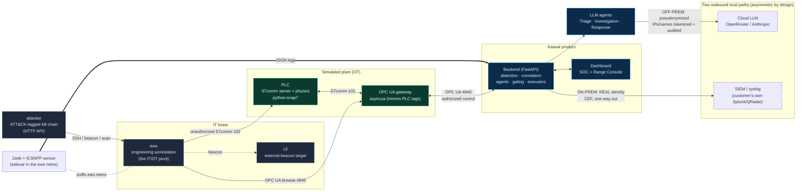

**Why the sensor sits in the ews network namespace:** every malicious flow originates from
or terminates at the engineering workstation. Running Zeek as a sidecar sharing the ews
namespace (`network_mode: "service:ews"`) captures the whole IT→OT chain from one vantage
point. Authorized OT access is the gateway/HMI only, so the ews speaking S7comm directly to
the PLC is anomalous by definition.

**The two outbound paths are deliberately different:**

- **Cloud LLM egress** leaves the premises, so it is **pseudonymized** — per-incident
  IP/asset tokens, a denylist scrub, and an immutable audit log. Real identity never crosses
  this boundary.
- **SIEM/CEF** is an **internal** destination on the customer's own premises, so it
  legitimately carries **real** asset identity (that's the point — correlation against their
  other logs). It is one-way out, off unless an admin enables it, and never routed through
  the cloud pseudonymizer.

---

## Step-by-step demo

Start the stack and open the two surfaces:

```bash
make up                     # http://localhost:8080/ (SOC)  +  /range (Range Console)
```

### 1. Baseline
Log in as the operator (`http://localhost:8080/?token=kaaval-operator`). The SOC shows no
active incident; the Range Console shows the pump station green and in-band (~5 bar, safety
interlock armed).

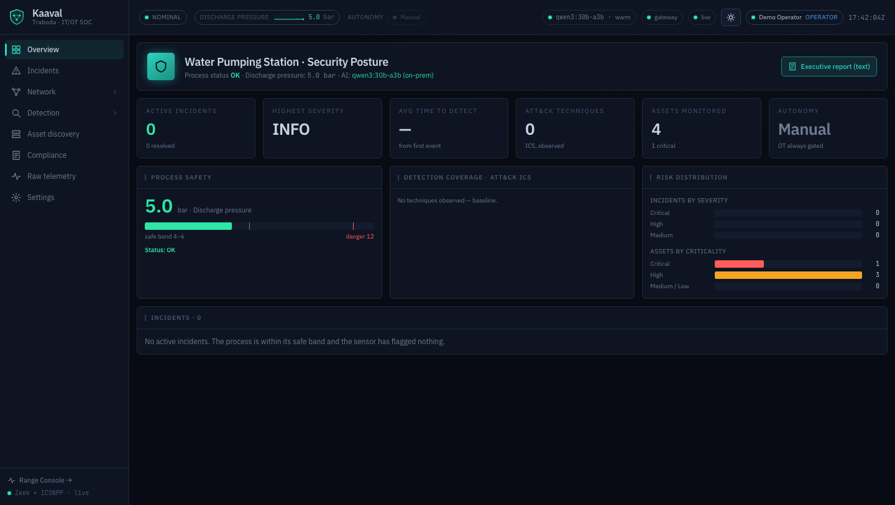


### 2. Launch the attack
Run `make demo` (or click **Launch full chain** on the Range Console). An external host
takes the ews over SSH, beacons to C2, scans the OT subnet, browses the OPC UA gateway, then
writes the PLC directly over S7comm — disabling the interlock and forcing the pump to max.
Watch discharge pressure climb toward the burst limit.

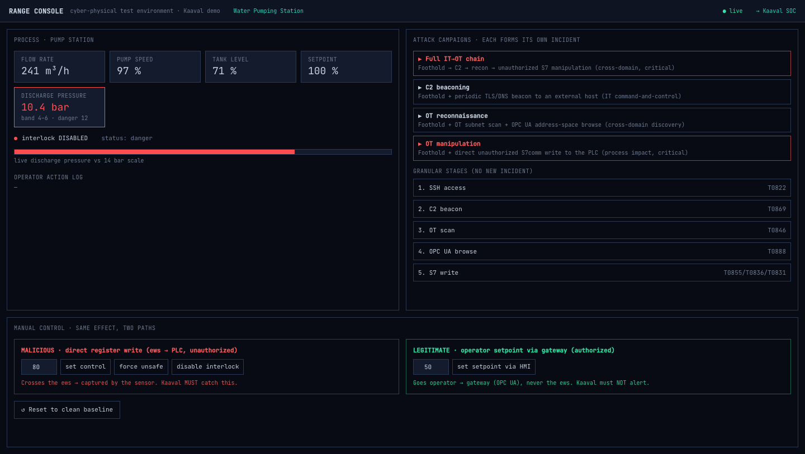

### 3. Detection + correlation
In the SOC, alerts stream in and the kill-chain shows **IT → ews pivot → OT** with
ATT&CK-ICS techniques. The stages fuse into **one critical cross-domain incident**.


### 4. Agents
Three agents run and stream their assessment: **Triage** rates severity/priority and the
process at risk; **Investigation** tells the IT→OT story, lists the attack chain and IOCs,
and maps ATT&CK; **Response** proposes graded actions and states why each gated action is gated.

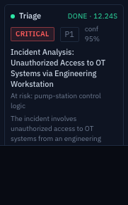
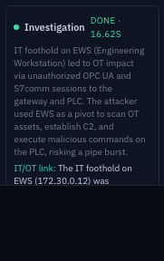
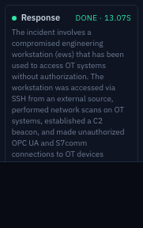

### 5. The human gate
Reversible **IT** containment (isolate the ews, block C2 egress, disable the account) is
auto-eligible. The **OT** recovery actions (re-arm the interlock, restore the setpoint) are
**held for human approval**.


Approving requires the **approver** role — the operator cannot approve its own investigation
(separation of duties). Switch to `http://localhost:8080/?token=kaaval-approver` and approve.

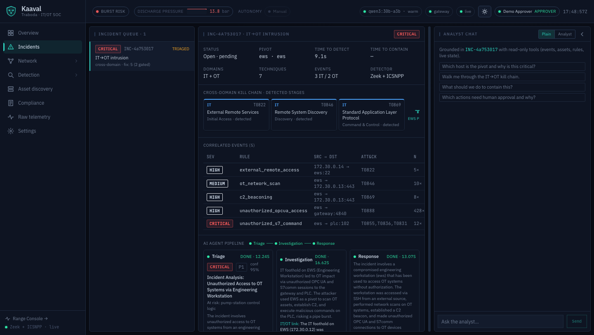

### 6. Recovery
Approval issues real OPC UA writes through the gateway control path; the PLC re-arms the
interlock and the pump returns to setpoint. The plant recovers to green on screen.

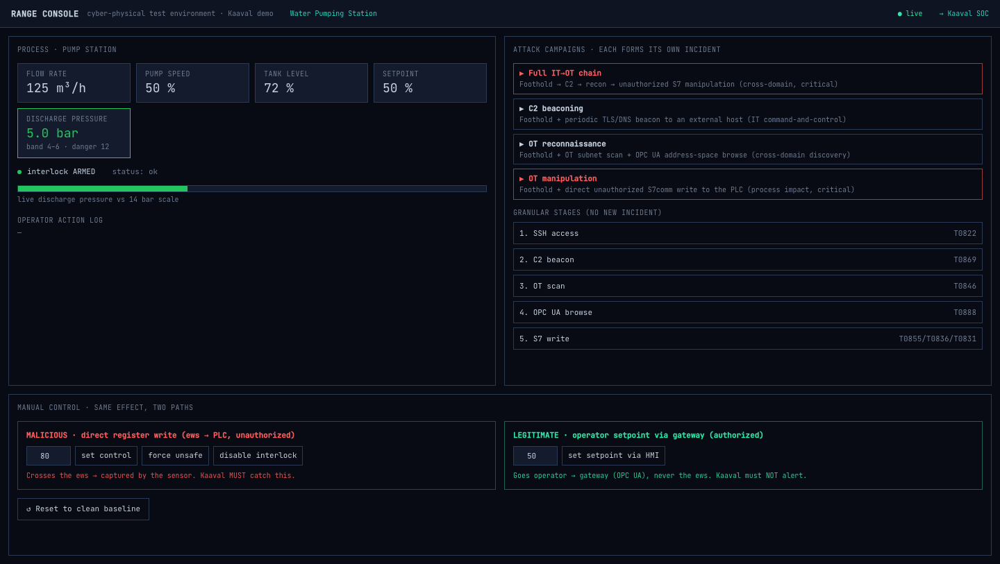

### 7. Explore the rest
Raw telemetry tail, detection rules + ATT&CK coverage, passive asset discovery, the Purdue
topology, the grounded analyst chat, and the case report / compliance export.

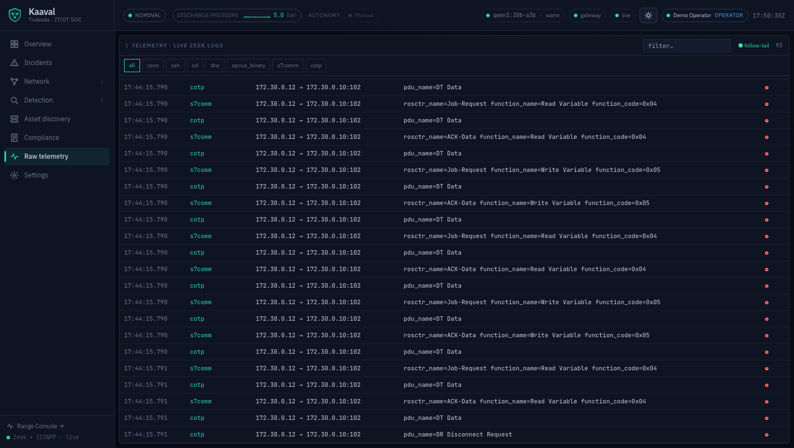
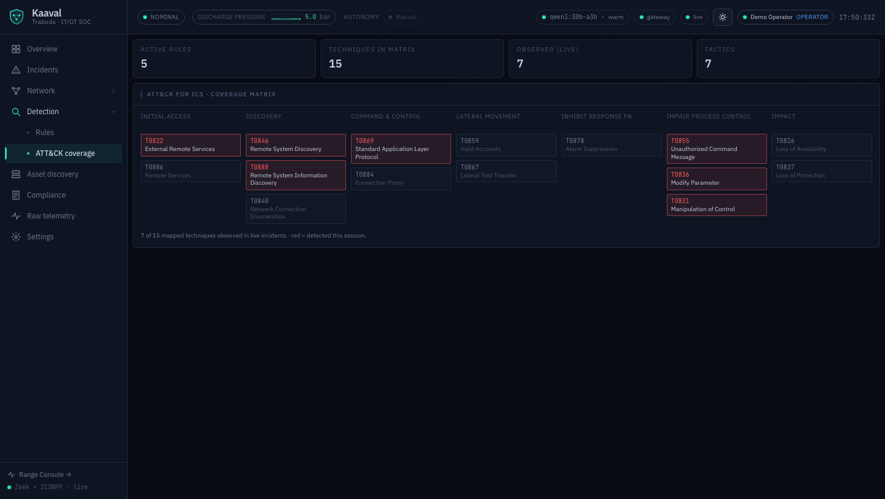
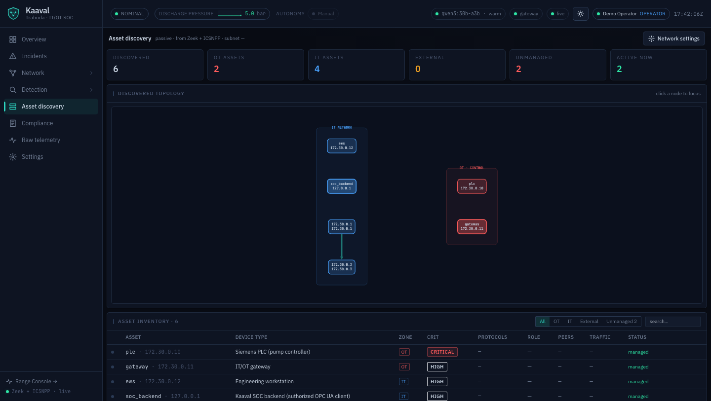
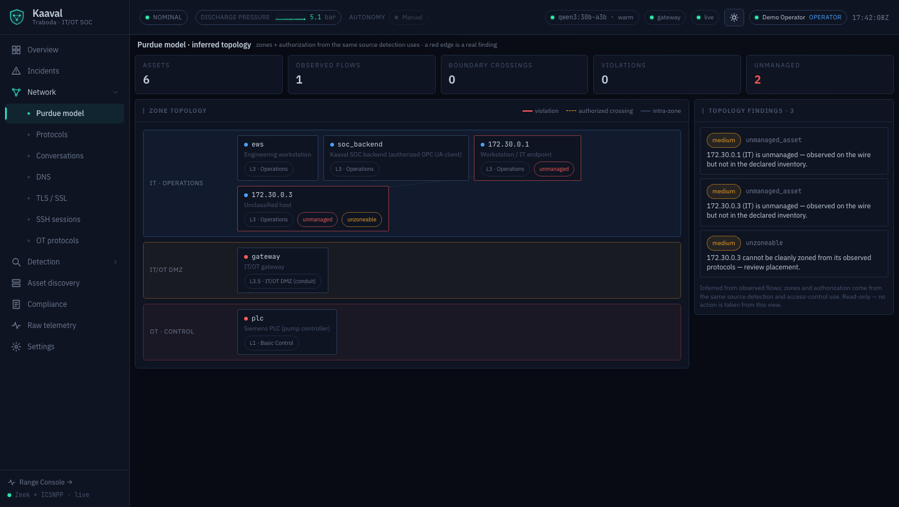
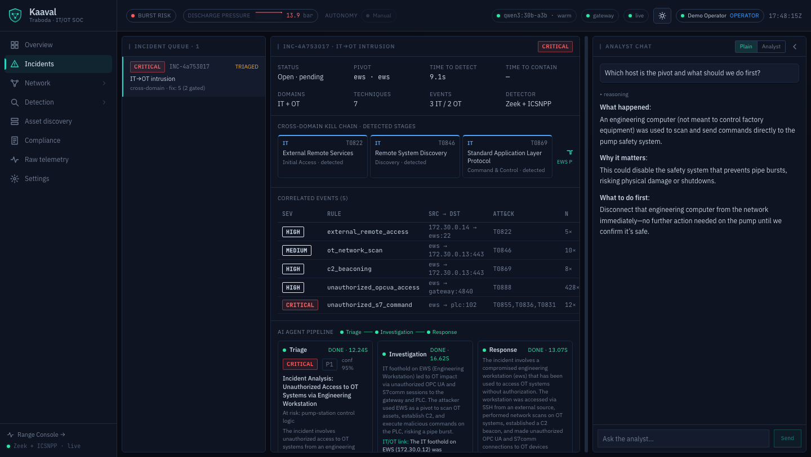
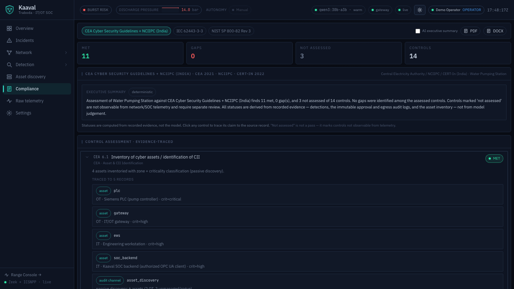

Reset to a clean baseline anytime with `make reset` (or the Reset button on either surface).

---

## OT-safety gating & separation of duties

The gate is the core product logic, enforced **server-side and fail-safe**:

- An action is **gated** (`requires_human_approval`) if it changes OT control state, is
  irreversible, or could affect the physical process — decided in code from the action's
  attributes (`control_plane` / `reversible` / `affects_process`), never by the LLM.
  **Unknown/unattributed ⇒ gated** (fail-safe).
- Only low-risk **reversible IT** actions may auto-run, and only under an explicit
  admin-enabled autonomy policy. **OT/control-plane actions are never auto-executed.**
- The **LLM never selects or triggers an action** — the action set is code-derived; the
  agents only advise.
- **Separation of duties:** approving a gated OT action requires the `approver` role. An
  operator-only principal is rejected (HTTP 403); an un-authenticated mutation is rejected
  (401). The approval records the verified principal in an immutable audit log.
- **Defense in depth:** the executor layer re-checks the gate in front of every adapter —
  the IT path refuses any gated action, the OT path refuses anything not gated-and-approved.
  Adapter success is confirmed by fresh post-action telemetry, not by trusting the adapter.

Settings → LLM lets an admin pick the provider/model; the trust boundary (pseudonymized
cloud egress vs. real-identity SIEM) is independent of that choice.

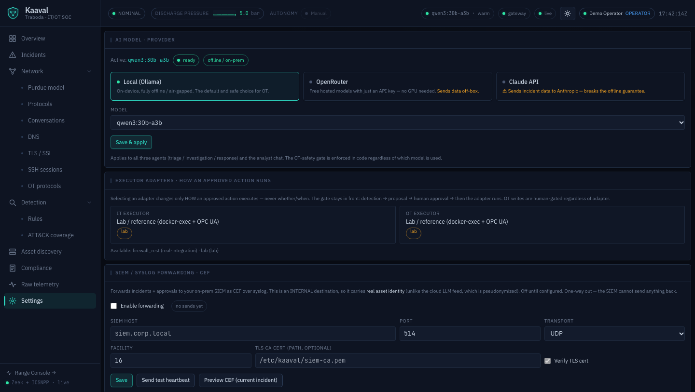

---

## Switching the LLM

Provider, mode, and model are env-driven (set in `.env`):

| Variable | Meaning |
|---|---|
| `KAAVAL_LLM_PROVIDER` | `openrouter` (default) · `anthropic` · `local` |
| `KAAVAL_LLM_MODEL` | any model slug for the active provider (blank = built-in default) |
| `OPENROUTER_API_KEY` / `ANTHROPIC_API_KEY` | cloud key (off-prem, pseudonymized egress) |
| `KAAVAL_OPENROUTER_URL` | override the OpenAI-compatible base URL |
| `OLLAMA_HOST` / `KAAVAL_MODEL` | local Ollama endpoint + model tag |

- **OpenRouter (default):** set `OPENROUTER_API_KEY`. Pick any model with `KAAVAL_LLM_MODEL`
  (e.g. a `:free` model). Off-prem ⇒ pseudonymized + audited automatically.
- **Local Ollama (offline):** `KAAVAL_LLM_PROVIDER=local`. On macOS run Ollama on the host
  (Metal); on Linux use `make local` (bundled container) and pull the model. No data leaves
  the box.

Changing the provider never changes whether/when an action executes — the gate sits in front.

---

## Troubleshooting

- **Port already in use** (`8080`, `8000`, `8090`, `4840`, `1102`, `2222`): another process
  holds the port. Stop it, or change the left-hand `127.0.0.1:PORT` mapping in
  `docker-compose.yml` (keep the `127.0.0.1:` prefix).
- **Missing / invalid LLM key:** agents render **degraded** cards ("…unavailable"), but the
  incident still forms and gates correctly — nothing crashes. Add `OPENROUTER_API_KEY` or
  switch to a local model.
- **Slow first build:** the sensor compiles Zeek + both ICSNPP plugins from source (~5–15 min,
  once). Subsequent builds use the cache. To prebuild for another arch:
  `docker buildx build --platform linux/amd64 -f sensor/Dockerfile ./sensor`.
- **Windows line endings:** run shell scripts from a WSL2 / Git-Bash shell. `.gitattributes`
  forces `*.sh` to LF so a CRLF checkout can't break the shebangs.
- **Docker memory:** if services are killed/unhealthy, raise Docker Desktop's memory limit
  (Settings → Resources) to ~6 GB+ (more for a local 30B model).
- **No incident after `make demo`:** give it 30–60 s (the backend polls the Zeek logs every
  2 s). Check `docker compose logs backend sensor`. `make reset` then retry.
- **Health check:** `curl http://localhost:8000/api/health` reports Ollama/gateway/sensor
  and the active LLM provider.
- **Tests:** `make test` runs the offline suite inside the backend container (or a local
  `.venv` for native dev).
